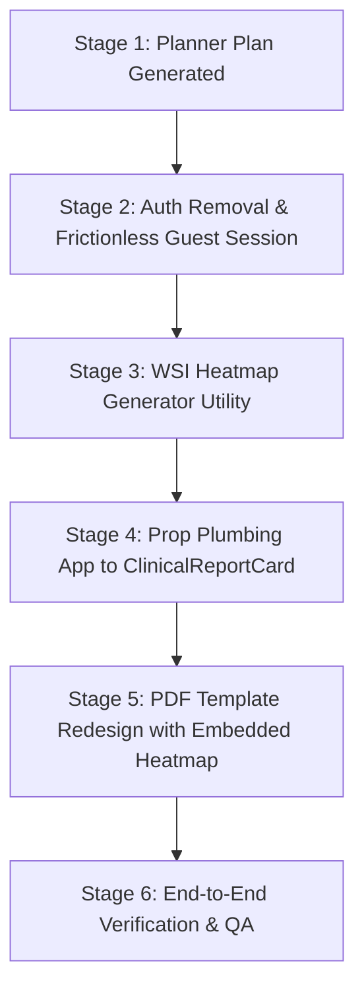

# Launch Readiness Implementation Plan: OncoBot Public Showcase & WSI PDF Integration

**Version:** 1.0.0  
**Role:** Stage 1 Planner Agent  
**Target Project:** `/Users/charancherry/dev/ccWorkSpace/Onco_Bot`  
**Status:** Ready for Multi-Agent Execution  

---

## 1. Executive Summary & Core Objectives

Before public launch, OncoBot requires two critical upgrades to function as a frictionless, high-impact clinical intelligence showcase:

1. **Eliminate Authentication Gating & Enforce Public Showcase Mode:**
   - Remove login/password walls and sign-in requirements so visitors immediately land on the interactive console, upload data, run analyses, and view results without barriers.
   - Maintain a pre-initialized, anonymous guest session (`Guest Clinician / Investigator`) so components requiring user context (e.g. report verification signatures, session logs, case counts) continue functioning flawlessly.
   - Streamline navigation to remove sign-in prompts and redirect legacy `/sign-in` traffic seamlessly to the console.

2. **Embed High-Resolution WSI Heatmap in Downloadable PDF Reports:**
   - Enhance the clinical report PDF export (`reportPdfGenerator.ts` triggered via `ClinicalReportCard.tsx`) to embed the Whole-Slide Image attention heatmap alongside the LLM-generated clinical decision text.
   - Ensure the heatmap figure includes colorbar calibration (0.0 to 1.0 attention weight), morphological region labeling, and attention metrics, formatted cleanly within the 2-page A4 PDF layout without clipping or layout shifts.

---

## 2. In-Depth Architectural Analysis

### 2.1 Current Authentication State & Dependencies

- **`frontend/src/App.tsx`:**
  - Defines `AppPage = 'home' | 'case-history' | 'results' | 'profile' | 'sign-in'`.
  - Reads route on load via `getPageFromPath()` (`/sign-in` routes to `SignInPage`).
  - Manages `currentUser` stored in `localStorage('oncobot-user')`. If cleared, `currentUser` becomes `null`.
  - Conditional rendering switches between pages; if `currentUser` is null, visiting `/profile` or clicking Profile renders `<SignInPage />`.
  - Signing out from `ProfilePage` triggers `setCurrentUser(null)` and pushes `/sign-in`, trapping the user in a login screen.

- **`frontend/src/components/Navbar.tsx`:**
  - Displays user pill if `user` exists; if `user` is null, displays an explicit `Sign In` button linking to `onOpenSignIn`.
  - Still contains legacy sign-in UI states that present friction for public showcase visitors.

- **`frontend/src/components/SignInPage.tsx` & `ProfilePage.tsx`:**
  - `SignInPage.tsx` is an explicit login gate prompting for Institutional Email / NPI and password.
  - `ProfilePage.tsx` contains a "Sign Out" button that clears the user session and redirects to sign-in.

**Simplification Strategy:**
- Define a permanent `ANONYMOUS_GUEST_USER: UserProfile` representing a guest clinical session:
  ```ts
  export const ANONYMOUS_GUEST_USER: UserProfile = {
    name: 'Guest Investigator',
    title: 'Visiting Clinical Oncologist & Researcher',
    email: 'guest@oncobot.app',
    institution: 'Public Research Showcase',
    department: 'Precision Oncology & Multimodal Therapeutics',
    licenseNumber: 'GUEST-PUBLIC-ACCESS',
    role: 'MD',
    casesReviewedCount: 0,
    lastLogin: 'Active Guest Session',
  };
  ```
- Make `currentUser` non-null by default (falling back to `ANONYMOUS_GUEST_USER`).
- Remove `'sign-in'` from navigation routes; if `/sign-in` is entered, redirect immediately to `'home'` (`/`).
- In `Navbar.tsx`, replace the "Sign In" button with an active "Guest Session" or "Workspace" pill.
- In `ProfilePage.tsx`, replace "Sign Out" with "Reset Session / Clear History", returning to the home console without unauthenticating.

---

### 2.2 WSI Heatmap Generation & PDF Embedding Pipeline

- **`frontend/src/components/WsiViewerCard.tsx`:**
  - Renders an interactive `<canvas>` (512x512) drawing the H&E cancer specimen (`wsi_specimen.jpg` or uploaded tissue) and overlays a jet/rainbow colormap based on patch attention weights.
  - Generates top 5 hotspots and tissue classifications.
  - Crucial limitation: `WsiViewerCard` is only rendered when the "Pathology (WSI)" tab or "all" tab is active. If the user is on the "Clinical Report" tab (`activeTab === 'report'`), `WsiViewerCard` is unmounted, so its DOM `<canvas>` cannot be referenced directly.

- **`server.py`:**
  - In `/api/heatmap/{patient_id}` and `/api/run-inference`, the backend generates:
    - `raw_wsi_base64`: Base64 PNG of the H&E morphology.
    - `heatmap_overlay_base64`: Base64 PNG of the colormap attention overlay.
    - `hotspots_base64`: Base64 PNG highlighting peak attention tiles.
    - `tiles`: Array of 1,024 patches with coordinates, attention weights, and tissue classifications.
  - The frontend receives this in `heatmapData` in `App.tsx`.

- **`frontend/src/components/ClinicalReportCard.tsx`:**
  - Currently receives `{ report, patientId, onRegenerate, isLoading }`.
  - It does NOT receive `heatmap` or any WSI image data.
  - Calls `exportClinicalReportPdf` in `utils/reportPdfGenerator.ts`.

- **`frontend/src/utils/reportPdfGenerator.ts`:**
  - Generates an off-screen HTML structure for Page 1 and Page 2.
  - Page 1 contains: Header, Patient Dossier, Tumor Specification, and Markdown Sections 1, 2, 3.
  - Page 2 contains: Markdown Sections 4, 5, Clinician Sign-Off, Verification Stamp, Disclaimer.
  - Uses `html2canvas` at 2x scale and `jsPDF` to build the multi-page A4 document.

**Heatmap Embedding Strategy:**
1. **Off-Screen Standalone Renderer / Compositor:**
   - Create a dedicated utility `generateWsiHeatmapDataUrl(heatmap: HeatmapData | null, patientId: string): Promise<string>` in `frontend/src/utils/wsiHeatmapExporter.ts`.
   - If `heatmap.heatmap_overlay_base64` and `heatmap.raw_wsi_base64` are present, compose them onto an off-screen canvas with an attention scale bar and return a data URL.
   - If base64 images are pending or absent, draw from `effectiveTiles` (the same robust rainbow algorithm as `WsiViewerCard`) over `/assets/wsi/wsi_specimen.jpg` onto an off-screen canvas.
   - This ensures a guaranteed, high-resolution 1024x1024 heatmap image is always available regardless of which UI tab is mounted.
2. **Prop Plumbing:**
   - Pass `heatmap: HeatmapData | null` through:
     - `App.tsx` -> `AnalysisResultsPage.tsx` -> `UnifiedDashboard.tsx` -> `ClinicalReportCard.tsx`.
3. **PDF Layout Integration:**
   - Extend `PdfReportOptions` in `reportPdfGenerator.ts` with `heatmapImageUrl?: string` and `wsiMetrics?: { topHotspotWeight?: number; hotspotCount?: number }`.
   - In Page 1 of the PDF, embed a styled **Figure 1: Whole-Slide Attention Heatmap & Hotspot Overlay**:
     - Embedded image with rounded borders and subtle drop-shadow.
     - Colormap gradient legend bar: `0.0 (Minimal Attention)` to `1.0 (Peak Attention / Invasive Margin)`.
     - Cross-attention summary badge linking Section 3 ("Whole-Slide Histopathology Correlates") to the visual figure.
   - Calibrate CSS spacing and heights so Page 1 remains within 1123px (A4 format) without overflowing onto Page 2.

---

## 3. Step-by-Step Multi-Agent Execution Plan



### Phase 1: Authentication Removal & Frictionless Guest Session
- **Task 1.1: Refactor App State & Routing (`frontend/src/App.tsx`)**
  - Define `ANONYMOUS_GUEST_USER` as default state.
  - Ensure `currentUser` is initialized to `ANONYMOUS_GUEST_USER` (or existing localStorage if customized).
  - Remove `'sign-in'` from `AppPage`.
  - Update `getPageFromPath`: map `/sign-in` to `'home'`, and keep `/profile` as guest profile.
  - In `handlePopState` and `navigateTo`, eliminate `'sign-in'` destination.
  - Remove `<SignInPage />` conditional render; render `ProfilePage` or console directly.
- **Task 1.2: Modernize Navbar (`frontend/src/components/Navbar.tsx`)**
  - Remove `isSignInPage` and `onOpenSignIn` props.
  - Replace the "Sign In" button with an "Anonymous Showcase / Guest Session" pill or direct profile toggle.
  - Show clinician initials ("GI" or user initials) with a subtle "Guest" indicator badge.
- **Task 1.3: Update Profile Page Actions (`frontend/src/components/ProfilePage.tsx`)**
  - Change "Sign Out" to "Reset Guest Session".
  - Clicking this clears custom session data/history in `localStorage` and resets to `ANONYMOUS_GUEST_USER`, navigating smoothly back to `'home'` without any login prompts.

---

### Phase 2: WSI Heatmap Image Generation & Data Flow Plumbing
- **Task 2.1: Implement Off-Screen WSI Composite Exporter (`frontend/src/utils/wsiHeatmapExporter.ts`)**
  - Implement `generateWsiHeatmapDataUrl(heatmap: HeatmapData | null, patientId: string): Promise<string>`.
  - Support both direct base64 compositing (`raw_wsi_base64` + `heatmap_overlay_base64`) and client-side canvas rendering of tiles over `/assets/wsi/wsi_specimen.jpg`.
  - Render an integrated colorbar legend (`0.0 Low` -> `1.0 High Attention`) at the bottom of the composite figure.
- **Task 2.2: Plumb `heatmap` Prop into `ClinicalReportCard`**
  - Update `ClinicalReportCardProps` in `ClinicalReportCard.tsx` to include `heatmap: HeatmapData | null`.
  - Update `UnifiedDashboard.tsx` to pass `heatmap={heatmap}` to `<ClinicalReportCard />`.
  - Update `AnalysisResultsPage.tsx` and `App.tsx` ensuring `heatmapData` reaches `ClinicalReportCard`.

---

### Phase 3: PDF Report Layout Enhancement with Embedded Heatmap Figure
- **Task 3.1: Update PDF Report Options (`frontend/src/utils/reportPdfGenerator.ts`)**
  - Add `heatmapImageUrl?: string` to `PdfReportOptions`.
  - Add `wsiHotspots?: { weight: number; tissue: string }[]`.
- **Task 3.2: Redesign Page 1 HTML Template (`buildPageOneHtml`)**
  - Under Section 3 (Whole-Slide Histopathology Correlates) or in a dedicated side-by-side card:
    - Render the WSI Heatmap image (width ~260-280px, height ~260-280px, high DPI).
    - Add colorbar gradient: Linear gradient from `#2a6e70` (Low) to `#dd8b2a` (Mid) to `#d63353` (Peak).
    - Add figure caption: *"Figure 1: DINO ViT-S/16 Cross-Attention Gigapixel Heatmap. Warm regions denote high spatial co-localization with genomic oncogenic drivers."*
  - Re-balance margins, font sizes, and section spacing to guarantee Page 1 fits within 1123px height.
- **Task 3.3: Wire Generation in `ClinicalReportCard.tsx`**
  - In `handleExportPdf()`, invoke `await generateWsiHeatmapDataUrl(heatmap, patientId)` before calling `exportClinicalReportPdf`.
  - Pass the resulting image data URL into `exportClinicalReportPdf({ ...options, heatmapImageUrl })`.
  - Add visual feedback: *"Generating high-resolution WSI heatmap and synthesizing PDF..."*.

---

### Phase 4: Edge Cases & Risk Mitigations

| Risk / Edge Case | Cause | Mitigation Strategy |
| :--- | :--- | :--- |
| **Heatmap canvas tainted by CORS** | Loading specimen image from external or unconfigured URL | Use local asset path (`/assets/wsi/wsi_specimen.jpg`), set `img.crossOrigin = 'anonymous'`, and fallback to procedural H&E grid if image load fails. |
| **PDF Page 1 vertical overflow** | Adding Figure 1 expands Page 1 beyond 1123px A4 height | Compact Section 1 & 2 margins and structure Section 3 with a 2-column layout (Histology findings on left, WSI Figure + Legend on right). |
| **User exports PDF before viewing WSI tab** | WSI canvas in `WsiViewerCard` is not mounted in DOM | Standalone `generateWsiHeatmapDataUrl` renders to an off-screen canvas using `heatmapData` state directly. |
| **Legacy bookmarks to `/sign-in`** | Users accessing cached URLs | Automatic redirect in `getPageFromPath()` and `navigateTo()` routes back to `/`. |
| **Session storage corruption** | Malformed data in `localStorage` | Wrap `localStorage.getItem` in try/catch and always fall back to `ANONYMOUS_GUEST_USER`. |

---

### Phase 5: Verification & Quality Assurance Checklist

- [ ] **Frictionless Entry:** Load `http://localhost:5173/` in a clean incognito window. App must immediately render Hero + Patient Upload Card with zero login dialogs.
- [ ] **Direct Navigation:** Enter `http://localhost:5173/sign-in` into the address bar; verify it automatically routes to the home console.
- [ ] **Guest Session Stability:** Verify the Navbar displays `Guest Investigator` or clinician badge with `0` initial cases. Run an analysis and confirm case history increments to `1`.
- [ ] **Reset Session:** Navigate to `/profile`, click "Reset Guest Session", and verify user returns to home with state cleanly re-initialized.
- [ ] **WSI Heatmap in PDF:** Run an analysis on `TCGA-2F-A9KO` (and an uploaded case). Navigate to the "Clinical Report" tab. Click "Export PDF".
- [ ] **PDF Visual Inspection:** Open the downloaded `.pdf` file. Verify:
  - Page 1 contains the crisp WSI attention heatmap figure with colorbar and caption.
  - Text and tables do not overflow or overlap page footers.
  - Page 2 maintains continuation headers, Section 4 & 5, and sign-off blocks.
- [ ] **Multi-Tab Reliability:** Export PDF from the "All-in-One Console" tab AND directly from the "Clinical Report" tab. Both must render identical high-res heatmaps.

---

## 4. Summary of Files to Modify

1. `frontend/src/App.tsx`: Remove auth gating, introduce `ANONYMOUS_GUEST_USER`, redirect `/sign-in`.
2. `frontend/src/components/Navbar.tsx`: Remove "Sign In" button, update profile/guest indicator.
3. `frontend/src/components/ProfilePage.tsx`: Replace "Sign Out" with "Reset Guest Session".
4. `frontend/src/components/ClinicalReportCard.tsx`: Accept `heatmap` prop and integrate heatmap generator in `handleExportPdf`.
5. `frontend/src/components/UnifiedDashboard.tsx`: Pass `heatmap` to `ClinicalReportCard`.
6. `frontend/src/utils/wsiHeatmapExporter.ts`: **New file** — Off-screen composite renderer for WSI + attention overlay + colorbar legend.
7. `frontend/src/utils/reportPdfGenerator.ts`: Update Page 1 HTML template to embed Figure 1 and calibrate A4 page height.

---
*Plan created by Planner Agent. Execution can proceed across Subagents or subsequent implementation phases.*
