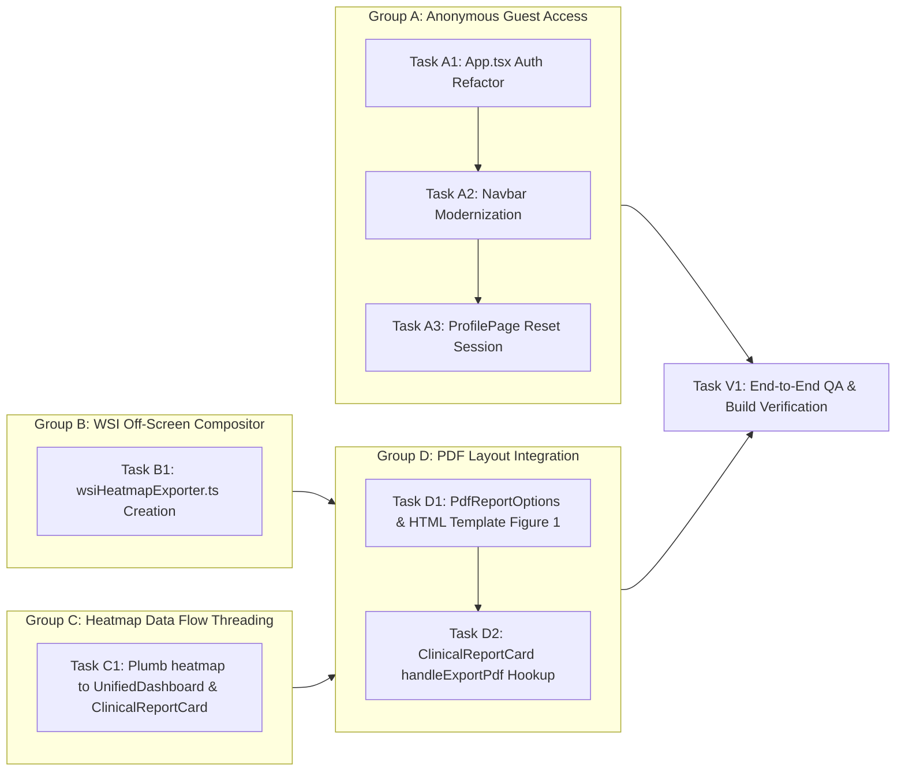

# OncoBot Task Board: Launch Readiness & WSI PDF Integration

**Status:** Completed  
**Target Path:** `/Users/charancherry/dev/ccWorkSpace/Onco_Bot`  
**Source Plan:** `.claude/state/launch_readiness_plan.md`  
**Last Updated:** 2026-10-12  

---

## 1. Overview & Execution Workflow

This board translates the technical plan into atomic, sequenced execution tasks organized across 4 Task Groups (A–D).



---

## 2. Work Packages & Task Breakdown

### Task Group A: Frictionless Anonymous Guest Access
**Objective:** Remove all login barriers and authentication gating. Guarantee visitors immediately enter the interactive showcase with an active anonymous guest clinician profile.

- [x] **Task A1: Refactor App State & Routing**
  - **Target File:** `frontend/src/App.tsx`
  - **Dependencies:** None
  - **Instructions:**
    1. Define `ANONYMOUS_GUEST_USER: UserProfile` with full guest details (`name: 'Guest Investigator'`, `role: 'MD'`, `licenseNumber: 'GUEST-PUBLIC-ACCESS'`, etc.).
    2. Initialize `currentUser` state to fall back to `ANONYMOUS_GUEST_USER` if `localStorage` has no user or corrupted data.
    3. Update `AppPage` union type: deprecate/remove `'sign-in'`.
    4. In `getPageFromPath()`, map `/sign-in` directly to `'home'` (`'/'`), ensuring legacy or direct `/sign-in` visits redirect to the main console.
    5. In `handlePopState()` and `navigateTo()`, eliminate routing to `'sign-in'`.
    6. Remove conditional rendering of `<SignInPage />`. If user visits `/profile`, render `<ProfilePage />` directly with `currentUser`.
  - **Validation Criteria:**
    - Visiting `/` directly lands on the console without login modals.
    - Visiting `/sign-in` automatically redirects to `/`.
    - No TypeScript errors regarding `AppPage` or `currentUser`.

- [x] **Task A2: Modernize Navbar Actions & Indicators**
  - **Target File:** `frontend/src/components/Navbar.tsx`
  - **Dependencies:** Task A1
  - **Instructions:**
    1. Remove unused `isSignInPage` and `onOpenSignIn` props from `NavbarProps`.
    2. Replace the legacy "Sign In" button with an active "Guest Investigator" / "Showcase Session" pill displaying clinician initials (`GI`) and a green active badge.
    3. Ensure clicking the profile pill routes cleanly to the profile page.
  - **Validation Criteria:**
    - Navbar never renders a "Sign In" button under any condition.
    - User badge displays guest clinician status cleanly on desktop and mobile.

- [x] **Task A3: Update Profile Actions to Reset Guest Session**
  - **Target File:** `frontend/src/components/ProfilePage.tsx`
  - **Dependencies:** Task A1
  - **Instructions:**
    1. Replace "Sign Out" button with "Reset Session / Clear History".
    2. In the reset handler, clear custom case histories and cached settings from `localStorage`, re-apply `ANONYMOUS_GUEST_USER`, and navigate back to `'home'`.
    3. Update badge/license displays to handle guest mode gracefully (displaying "Public Showcase / Guest Investigator").
  - **Validation Criteria:**
    - Clicking "Reset Session" clears stored session history and smoothly redirects to `'home'`.
    - No unauthenticated state or login prompt is presented.

---

### Task Group B: WSI Heatmap Off-Screen Compositor
**Objective:** Provide a standalone, headless utility to compose the high-resolution tissue image, attention heatmap overlay, colorbar legend, and metrics into a data URL without depending on a mounted DOM canvas.

- [x] **Task B1: Implement `wsiHeatmapExporter.ts`**
  - **Target File:** `frontend/src/utils/wsiHeatmapExporter.ts` (New file)
  - **Dependencies:** None (Can run in parallel with Group A)
  - **Instructions:**
    1. Create utility function:
       ```ts
       export async function generateWsiHeatmapDataUrl(
         heatmap: HeatmapData | null,
         patientId: string
       ): Promise<string>
       ```
    2. Handle primary composite path:
       - If `heatmap.heatmap_overlay_base64` and `heatmap.raw_wsi_base64` exist, load them onto an off-screen HTML `<canvas>` (e.g. 1024x1024 or 512x512 with 2x scaling).
       - Composite the H&E raw tissue as the base layer, overlay the attention heatmap with appropriate alpha blending (e.g. 0.65).
    3. Handle client-side tile fallback path:
       - If pre-rendered base64 overlays are missing, load `/assets/wsi/wsi_specimen.jpg` (with `crossOrigin = 'anonymous'`).
       - Render the patch attention weights across the 32x32 grid using the standard jet/rainbow colormap algorithm (`#2a6e70` -> `#dd8b2a` -> `#d63353`).
       - If specimen image fails to load, draw a high-contrast procedural H&E background grid as a safe fallback.
    4. Render integrated Colorbar Legend at the base of the image:
       - Draw horizontal linear gradient with markers: `0.0 (Minimal)`, `0.5 (Intermediate)`, `1.0 (Peak Attention)`.
       - Add labels for peak hotspot tile and morphological focus.
    5. Return canvas output as high-quality PNG data URL (`canvas.toDataURL('image/png', 0.95)`).
  - **Validation Criteria:**
    - Generates a valid `data:image/png;base64,...` string.
    - Gracefully handles `null` heatmap input by providing a calibrated placeholder tissue composite.
    - Free of DOM mounting dependencies (`document.createElement('canvas')` executes headlessly).

---

### Task Group C: Heatmap Data Flow Threading
**Objective:** Ensure the full `HeatmapData` object is plumbed through component hierarchies to `ClinicalReportCard`, so PDF export has immediate access to WSI metrics and overlays regardless of active UI tab.

- [x] **Task C1: Plumb `heatmap` Prop through Component Hierarchy**
  - **Target Files:**
    - `frontend/src/components/ClinicalReportCard.tsx`
    - `frontend/src/components/UnifiedDashboard.tsx`
    - `frontend/src/components/AnalysisResultsPage.tsx`
    - `frontend/src/App.tsx`
  - **Dependencies:** None
  - **Instructions:**
    1. In `ClinicalReportCard.tsx`, extend `ClinicalReportCardProps` with `heatmap: HeatmapData | null`.
    2. In `UnifiedDashboard.tsx`, receive `heatmap` prop (or use existing available `heatmapData`) and pass it to `<ClinicalReportCard heatmap={heatmap} ... />`.
    3. In `AnalysisResultsPage.tsx`, verify `heatmapData` is forwarded to `UnifiedDashboard`.
    4. In `App.tsx`, verify `heatmapData` state is passed down to `AnalysisResultsPage`.
  - **Validation Criteria:**
    - TypeScript compiles with zero prop mismatch or missing prop errors.
    - Inside `ClinicalReportCard.tsx`, `props.heatmap` contains the active patient's tiles and overlays when an analysis completes.

---

### Task Group D: PDF Layout Integration
**Objective:** Redesign Section 3 of Page 1 in the multi-page clinical PDF report to embed Figure 1 (WSI attention heatmap, legend, and caption) while preserving strict 2-page A4 vertical budgeting.

- [x] **Task D1: Update PDF Report Options & Page 1 HTML Template**
  - **Target File:** `frontend/src/utils/reportPdfGenerator.ts`
  - **Dependencies:** Task B1
  - **Instructions:**
    1. Extend `PdfReportOptions` interface:
       ```ts
       export interface PdfReportOptions {
         ...
         heatmapImageUrl?: string;
         wsiHotspots?: Array<{ weight: number; tissue: string }>;
       }
       ```
    2. In `buildPageOneHtml()`, under or beside Section 3 (*Whole-Slide Histopathology Correlates*):
       - Create a structured 2-column layout or dedicated visual figure container:
         - **Left Column:** Markdown histopathology correlates and micro-environment findings.
         - **Right Column / Embedded Card:**
           - Crisp `` tag with `src="${options.heatmapImageUrl}"` (dimensions ~240x240px to 260x260px, rounded corners, subtle border `#e2e8f0`).
           - Colorbar legend bar rendering gradient `#2a6e70` -> `#dd8b2a` -> `#d63353` with labels `0.0 (Stroma)` to `1.0 (Tumor Peak)`.
           - Figure caption: *"Figure 1: DINO ViT-S/16 Cross-Attention Gigapixel Heatmap. Warm regions denote high spatial co-localization with genomic oncogenic drivers."*
    3. Compact vertical margins, padding, and font sizes across Sections 1 & 2 to ensure Page 1 content fits within 1123px (A4 height at standard 96 DPI / 2x scale) without spilling into Page 2.
    4. Maintain Page 2 integrity: Sections 4 & 5, Clinical Sign-Off, Verification Stamp, and Disclaimer remain intact.
  - **Validation Criteria:**
    - Generated Page 1 contains Figure 1 clearly rendered with caption and legend.
    - No page height overflow: Page 1 does not spill over onto Page 2; Page 2 remains exactly 1 page.

- [x] **Task D2: Hook Up Heatmap Generation in `ClinicalReportCard`**
  - **Target File:** `frontend/src/components/ClinicalReportCard.tsx`
  - **Dependencies:** Task B1, Task C1, Task D1
  - **Instructions:**
    1. Import `generateWsiHeatmapDataUrl` from `../utils/wsiHeatmapExporter`.
    2. In `handleExportPdf()`:
       - Update UI loading state with status message: *"Generating high-resolution WSI heatmap and synthesizing PDF..."*.
       - Call `const heatmapImageUrl = await generateWsiHeatmapDataUrl(heatmap, patientId);`.
       - Pass `heatmapImageUrl` and hotspot metrics into `exportClinicalReportPdf({ ...options, heatmapImageUrl })`.
    3. Provide graceful fallback if generation fails (proceed with text-only PDF export and log warning).
  - **Validation Criteria:**
    - Clicking "Export PDF" from the "Clinical Report" tab generates the PDF with embedded Figure 1 even when the "Pathology (WSI)" tab was never viewed.
    - Export button displays loading spinner during composite generation and PDF synthesis.

---

### Task Group V: Verification & Quality Assurance
**Objective:** End-to-end verification of all workflows and artifact exports.

- [x] **Task V1: End-to-End QA & Build Verification**
  - **Dependencies:** All previous tasks
  - **Instructions:**
    1. Run `npm run build` (or `tsc`) in `frontend` to verify TypeScript compile health.
    2. Verify guest session in browser:
       - Direct load at `/` -> Home console with active `Guest Investigator`.
       - Direct load at `/sign-in` -> Smoothly redirected to `/`.
       - Direct load at `/profile` -> Profile view with "Reset Session" button.
    3. Verify WSI PDF Export:
       - Run analysis on standard patient (e.g. `TCGA-2F-A9KO`).
       - Switch to "Clinical Report" tab and click "Export PDF".
       - Inspect generated PDF: verify Page 1 layout, Figure 1 image, colorbar, and Page 2 continuation.
  - **Validation Criteria:**
    - Zero TypeScript / lint errors.
    - PDF download works reliably with embedded visual heatmap on all supported cases.

---

## 3. Implementation Order & Responsibility Matrix

| Step | Task ID | Description | Primary File(s) | Dependencies | Status |
| :--- | :--- | :--- | :--- | :--- | :--- |
| 1 | **A1** | App.tsx Auth Refactor | `frontend/src/App.tsx` | None | **Completed** |
| 2 | **A2** | Navbar Modernization | `frontend/src/components/Navbar.tsx` | A1 | **Completed** |
| 3 | **A3** | ProfilePage Reset Session | `frontend/src/components/ProfilePage.tsx` | A1 | **Completed** |
| 4 | **B1** | WSI Off-Screen Compositor | `frontend/src/utils/wsiHeatmapExporter.ts` | None | **Completed** |
| 5 | **C1** | Heatmap Prop Threading | `App.tsx`, `AnalysisResultsPage.tsx`, `UnifiedDashboard.tsx`, `ClinicalReportCard.tsx` | None | **Completed** |
| 6 | **D1** | PDF Template & Figure 1 Layout | `frontend/src/utils/reportPdfGenerator.ts` | B1 | **Completed** |
| 7 | **D2** | Wire Export in ClinicalReportCard | `frontend/src/components/ClinicalReportCard.tsx` | B1, C1, D1 | **Completed** |
| 8 | **V1** | Full Build & End-to-End QA | Whole project | A1-A3, B1, C1, D1-D2 | **Completed** |

---

*Task Board maintained by Task Manager Agent. Hand off to Implementer Agent.*

